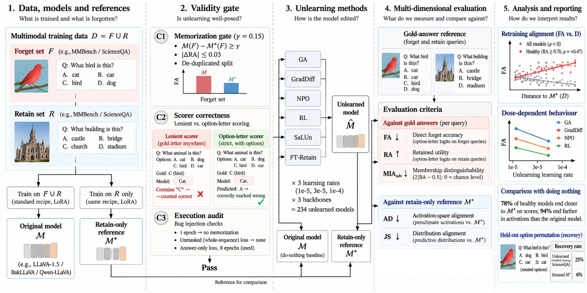
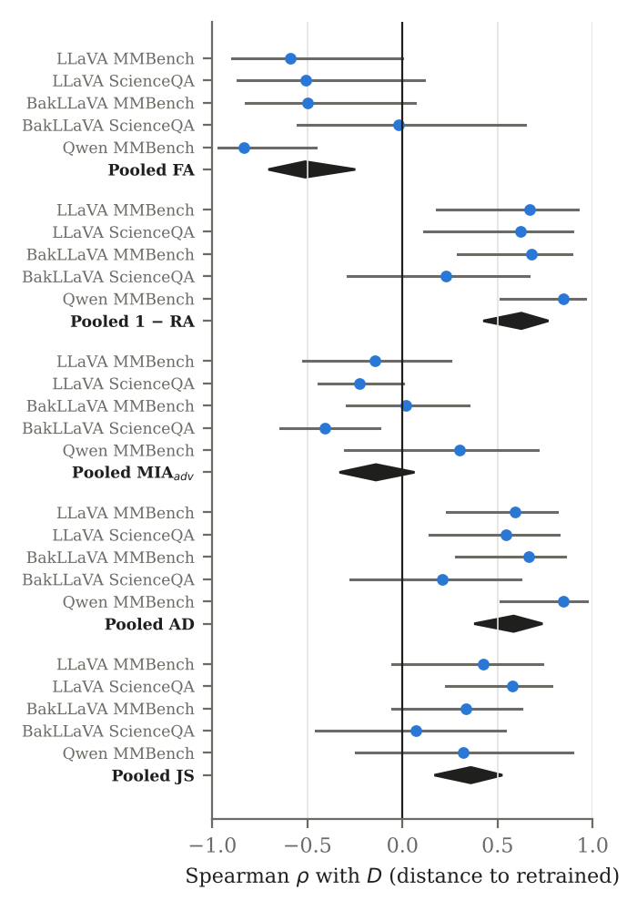
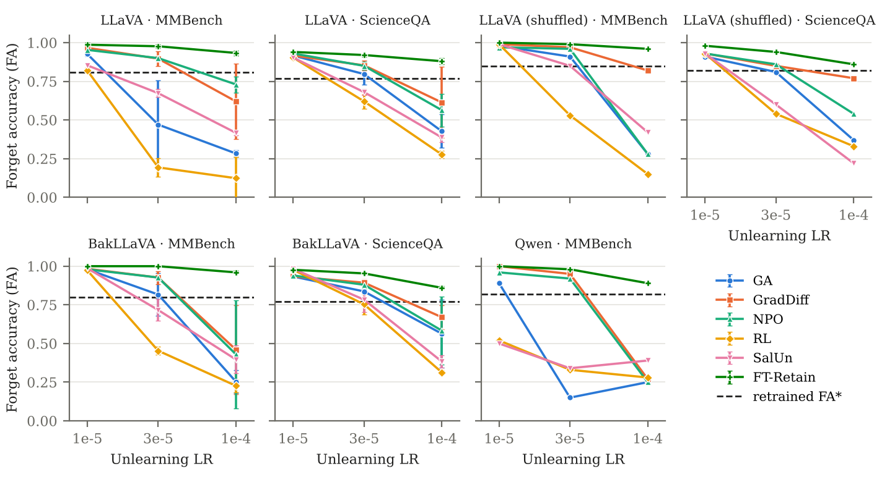
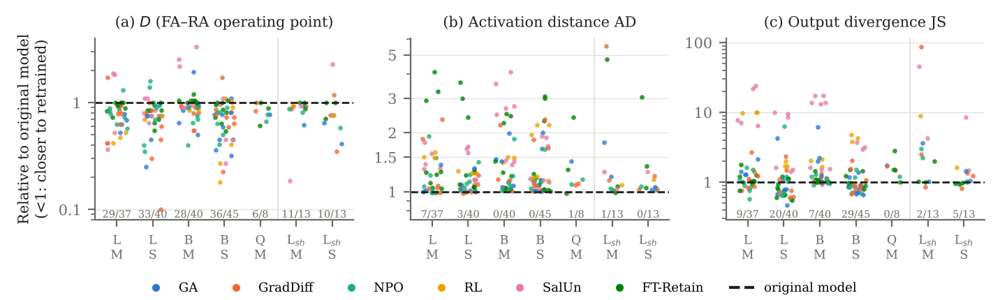

<div align="center">

# Validity-Gated Evaluation of Multimodal Machine Unlearning

**Abdullah Ahmad Khan · Hamid Laga · Ferdous Sohel**
<br>Murdoch University, Perth, Australia


</div>

> **Before you compare unlearning methods, check that the evaluation itself works.**
> VGUA (validity-gated unlearning audit) tests three conditions that every multimodal-unlearning
> evaluation silently depends on, and then asks whether the usual scores agree with a model retrained
> without the forget data.

<p align="center">
  
</p>

---

## Key findings

| | Finding | Number |
|---|---|---|
| 1 | **Each validity condition fails in a realistic pipeline**, and the run still completes normally | MMBench: 4,377 rows but only 1,175 unique questions |
| 2 | **Forget accuracy (FA) is regime-dependent.** Among healthy models (RA ≥ 0.70), lower FA means closer to retraining | pooled ρ(FA, D) = **+0.47** |
| 3 | Aggressive updates overshoot, collapse RA, and **reverse the FA ranking of methods** | Kendall τ(FA, D) at lr 1e-4: **−1.00** / **−0.87** |
| 4 | Unlearning **matches the retrained scores but not the retrained model** | 132 / 170 closer on scores, **159 / 170 farther** in activations |
| 5 | **Membership-inference advantage does not track retraining** | pooled ρ = −0.14, 95% CI [−0.33, 0.06] |
| 6 | **Low FA can hide knowledge**: after option-shuffled training, forgotten answers come back when options are reordered | **25%** recovered vs **6%** for the retrained model (ScienceQA) |

Study size: **234** unlearned models (6 methods × 3 learning rates × 3 backbones, 3 seeds for LLaVA and BakLLaVA)
plus **36** option-shuffled models. Backbones: LLaVA-1.5-7B, BakLLaVA, LLaVA-Interleave-Qwen-7B.
Benchmarks: de-duplicated MMBench and ScienceQA (100 forget / 900 retain questions).

---

## Quick start: reproduce the paper (CPU, one command)

```bash
pip install numpy scipy matplotlib
python reproduce_paper.py
```

The script recomputes every statistic and figure from the released results, checks the aggregated data against
all 270 raw per-model files, and prints each headline number next to the value in the paper:

```text
[4] Aggregated data vs. raw per-model files in outputs*/
  outputs           rows 108 | raw files found 108 | values compared  540 | differing 0
  outputs_bakllava  rows 108 | raw files found 108 | values compared  540 | differing 0
  outputs_qwen      rows  18 | raw files found  18 | values compared   90 | differing 0
  outputs_shuffle   rows  36 | raw files found  36 | values compared  180 | differing 0

[5] Headline results: reproduced vs. paper
  OK    Pooled rho(FA, D), all models                        reproduced   -0.512   paper -0.51
  OK    Pooled rho(FA, D), healthy models (RA>=0.70)         reproduced   +0.467   paper 0.47
  OK    Pooled rho(MIA adv, D)                               reproduced   -0.139   paper -0.14
  OK    Healthy models closer than the original on D         reproduced      132   paper 132
  OK    Healthy models farther than the original on AD       reproduced      159   paper 159
  OK    Recovery, ScienceQA, unlearned (shuffled training)   reproduced   +0.251   paper 0.25
  ...
ALL HEADLINE NUMBERS MATCH THE PAPER.
```

Runtime is about 5–15 minutes (cluster bootstrap). Everything is written to `reproduced/`, including `REPORT.txt`.

---

## The three validity conditions

| Condition | What must hold | How it fails in practice |
|---|---|---|
| **C1 Conditioning** | The forget set is memorized before unlearning (FA gap original − retrained ≥ 0.15, ΔRA ≤ 0.03) and is not duplicated in the retain set | MLLMU-Bench gap is only 0.127; random MMBench splits leak a duplicate of about half the forget questions into the retain set |
| **C2 Measurement** | The scorer measures correctness | Without options in the prompt, a lenient "letter appears anywhere" scorer gives the gold letter 0.87 and a wrong letter 0.84; the memorization gap falls from 0.18 to 0.04 |
| **C3 Execution** | The training code does what it claims | Two plausible bugs (a single epoch, an unmasked loss) remove all forget-specific memorization while training finishes normally |

Settings that pass all three: LLaVA and BakLLaVA on both benchmarks and Qwen on MMBench (gaps 0.18–0.21).

---

## Results

### Do the usual criteria track the retrained model?

Spearman ρ between each criterion and *D*, the distance to the retrained FA–RA operating point
(for a lower-is-better criterion, positive means it tracks retraining):

| Criterion | Pooled ρ (95% CI) | Reading |
|---|---|---|
| FA | −0.51 [−0.70, −0.25] | lower FA goes with *farther* from retraining, driven by collapsed models |
| 1 − RA | +0.63 [+0.42, +0.77] | tracks *D* (partly by construction) |
| MIA<sub>adv</sub> | −0.14 [−0.33, +0.06] | no reliable relationship |
| AD (activations) | +0.58 [+0.38, +0.74] | tracks *D*, but needs the retrained model |
| JS (outputs) | +0.36 [+0.17, +0.53] | tracks *D*, but needs the retrained model |

<p align="center">
  
</p>

### The operating regime decides what FA means

<p align="center">
  
</p>

At 1e-5 most methods barely move. At 1e-4 GA, RL, SalUn, NPO, and GradDiff push FA far below the retrained value
(dashed line) and RA collapses with it. For LLaVA, the FA ranking of methods agrees with the *D* ranking at 1e-5
(τ = +0.87, +0.96) and is reversed at 1e-4 (τ = −1.00, −0.87). A comparison at a single learning rate says as
much about the dose as about the method.

### Closer to retraining than doing nothing?

<p align="center">
  
</p>

Each dot is a healthy unlearned model relative to the original model (below 1 = closer to the retrained model).
On the FA–RA scores most models improve (**132 of 170**); in activation space almost none do (**159 of 170 are farther**,
and the 11 exceptions are at most 2.2% closer).

### Recoverable knowledge

| Training | Benchmark | Unlearned models recover | Retrained model recovers |
|---|---|---|---|
| Option-shuffled | ScienceQA | **25%** | 6% |
| Option-shuffled | MMBench | 9% | 7% |

Share of forget questions answered wrongly in the original option order but correctly in every rotated and reversed order.

---

## Repository layout

```text
.
├── reproduce_paper.py           # one-command reproduction of all statistics and figures
├── paper_analysis/              # analysis scripts + aggregated results used by reproduce_paper.py
│   ├── analysis_figures.py      #   correlations, pooling, dose response, forest plot
│   ├── noncollapse.py           #   collapse-stratified analysis
│   ├── original_comparison.py   #   do-nothing baseline
│   └── data/, data_refs/        #   per-backbone results, original and retrained reference rows
├── outputs*/                    # raw per-model results (LLaVA, BakLLaVA, Qwen, option-shuffled)
├── main.py, config.py           # unlearning pipeline
├── unlearning/methods.py        # GA, GradDiff, NPO, RL, SalUn, FT-Retain
├── evaluation/metrics.py        # FA, RA, MIA advantage, AD, JS, effective-update distance
├── memorization_gate.py         # C1
├── scorer_audit.py              # C2
├── bug_injection.py             # C3
├── heldout_eval.py, variants.py # held-out and option-rotated evaluation
└── docs/                        # figures used in this README
```

---

## Re-running the GPU experiments

Base models and datasets download from Hugging Face on first use. Exact package versions are in
`requirements_tnnls_freeze.txt`. All experiments ran on one NVIDIA RTX 4090 (24 GB).

```powershell
pip install -r requirements.txt
.\run_fixed_pipeline.ps1                     # LLaVA-1.5: training, memorization gate, unlearning sweep, evaluation
python scorer_audit.py                       # C2 scorer audit
python bug_injection.py                      # C3 bug injection
.\backbone2\overnight_backbone2.ps1          # BakLLaVA, seed 42
.\bakllava_seeds\run_bakllava_seeds.ps1      # BakLLaVA, seeds 123 and 5508
.\run_steps234.ps1                           # option-shuffled LLaVA, Qwen-based LLaVA, held-out evaluation
```

Each script describes its stages in its header comment and skips models that already exist.

---

## Citation

```bibtex
@misc{khan2026vgua,
  title  = {Validity-Gated Evaluation of Multimodal Machine Unlearning},
  author = {Khan, Abdullah Ahmad and Laga, Hamid and Sohel, Ferdous},
  year   = {2026},
  note   = {Under review}
}
```

## License

See [`LICENSE`](LICENSE).
